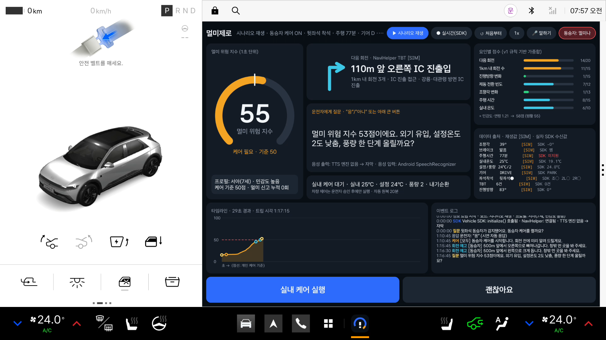
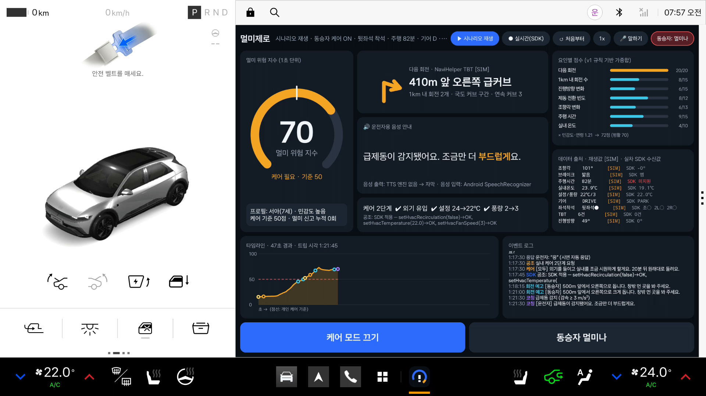
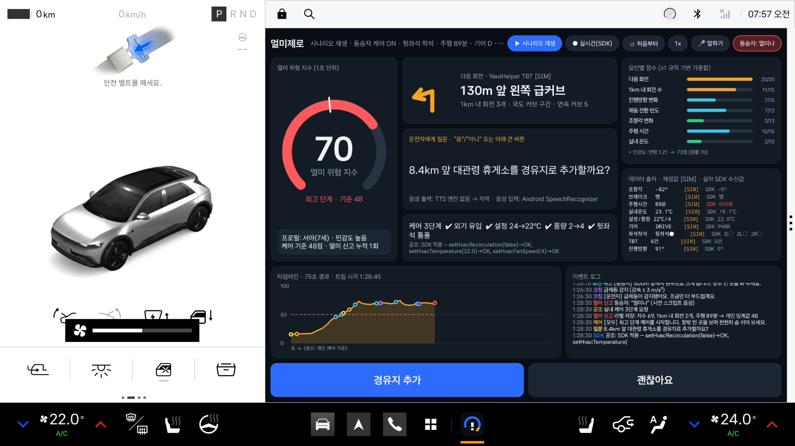
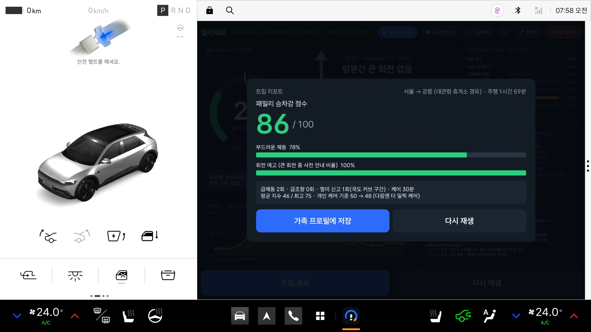
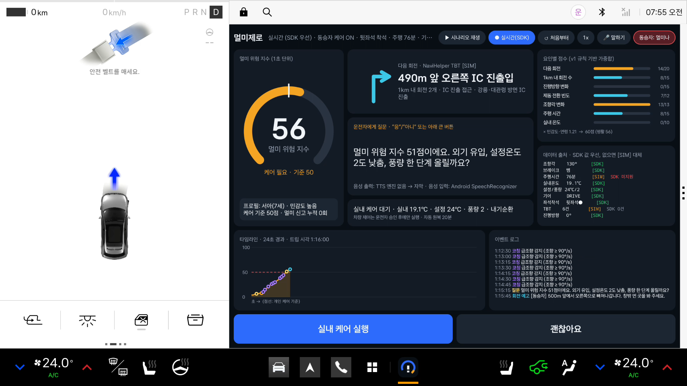

# 멀미제로 (MulmiZero)

**다가올 회전과 차량 움직임을 미리 읽어 뒷좌석 동승자의 멀미를 예측하고, 회전 예고 음성·실내 공조 케어·휴게소/편안한 길 제안으로 멀미를 줄이는 Pleos Connect용 패밀리 케어 앱.**

2026 현대자동차그룹 차량용 앱 개발 공모전에 제출한 기획서의 **실제 동작하는 시연판**입니다. Pleos Connect Emulator(AVD v2.1)에서 실행되며, Pleos Vehicle SDK와 NaviHelper SDK를 실제로 연동합니다.

- 시연 영상: [`docs/demo.mp4`](docs/demo.mp4) (2분 56초, 1920×1080)
  - ① 시나리오 재생 "주말 가족여행" (2분 압축, 1배속). 공조 케어는 실제 Vehicle SDK로 에뮬레이터에 적용됨 (화면 하단 운전석 온도 24℃→22℃→24℃)
  - ② 실시간 모드. Virtual Console에서 기어·조향각·브레이크·좌석을 바꾸면 앱이 Vehicle SDK로 받아 지수를 계산하고, 운전자가 승인하면 공조를 제어
- 설치 파일: [`apk/양호영_멀미제로_release.apk`](apk/) (release 서명, minSdk 28 / targetSdk 34)

## 스크린샷

| | |
|---|---|
|  지수가 개인 기준(50)을 넘자 운전자에게 공조 케어 승인 요청 |  커브 구간: 급제동 코칭, Vehicle SDK로 외기·설정온도·풍량 적용 |
|  "멀미나" 신고 → 최고 단계 케어 + 휴게소 경유지 제안 |  주차 후 트립 리포트 (패밀리 승차감 점수, 개인 케어 기준 50→48) |
|  실시간 모드: 신호별 출처 `[SDK]`/`[SIM]` 표시 | |

## 기능 (기획서 범위)

| 기획 기능 | 시연판 구현 |
|---|---|
| F1 멀미 위험 지수 0~100, 1초 단위 | `FeatureEngine` → `RiskModel` (v1 규칙 기반 가중합) → EMA 평활. 요인별 점수를 화면에 표시 |
| F2 회전 예고 음성 (동승자용) | 큰 회전(급커브·IC·회전교차로·좌/우회전) 250~520m 전에 1회: "300m 앞에서 왼쪽으로 크게 돕니다. 창밖 먼 곳을 봐 주세요." |
| F3 실내 자동 케어 | 지수 ≥ 개인 기준 → 운전자 승인 → 외기 유입·설정온도 −2℃·풍량 +1 (멀미나: 풍량 +2, 2열 통풍). 20분(트립 시각) 뒤 지수가 낮으면 자동 원복 |
| F4 부드러운 운전 코칭 | 급제동(브레이크 + 감속 ≥ 3 m/s²)·급조향(≥ 90°/s) 시 운전자에게 짧은 음성, 15초 쿨다운. 리포트에 집계 |
| F5 편안한 길·휴식 제안 | 지수가 높은 상태가 15초 넘게 이어지고 1km 안에 회전이 3개 이상이면 `RouteOption.COMFORTABLE` 재탐색 제안. 멀미 신고 시 다음 휴게소 경유지 제안 (`addWaypoint`) |
| F6 "멀미나" 신고와 개인화 | 음성/버튼 → 최고 단계 케어, 그 시점의 특징을 라벨로 기기 내 저장, 개인 케어 기준을 낮춤 |
| 트립 리포트 | 패밀리 승차감 점수 = 100 − 3·급제동 − 1.5·급조향 − 5·멀미신고 − 0.3·max(0, 평균지수 − 35) |
| 조작 최소화 | 큰 버튼 2개(질문의 예/아니오) + 음성. 질문은 한 번에 하나, 20초 뒤 자동 만료 |

### 위험 지수 v1 (가중치 합 100)

| 요인 | 가중치 | 1.0이 되는 값 |
|---|---|---|
| 다음 회전 (TBT 유형 심각도 × 근접도, 500m 이내 100%, 1.5km 이상 0%) | 20 | 급커브 500m 이내 |
| 1km 내 회전 수 | 15 | 4개 |
| 진행방향 변화율 (최근 10초) | 15 | 12°/s |
| 제동 전환 빈도 (최근 60초) | 12 | 10회/분 |
| 조향각 변화량 (최근 10초) | 13 | 60°/s |
| 주행 시간 | 15 | 30분부터 증가, 120분에 1.0 |
| 실내 온도 | 10 | 22℃부터 증가, 27℃에 1.0 |

합계 × 민감도(낮음 0.85 / 보통 1.0 / 높음 1.15) × 아동 1.05 × (동승자 없음 0.5). 개인 케어 기준은 민감도별로 62/55/50에서 시작하며, "멀미나" 신고 한 번마다 최소 2점 내려갑니다(신고 시점 지수 −15 쪽으로 30% 이동).

## 실제 SDK 연동과 시뮬레이션 구분

에뮬레이터에서 실제로 확인한 결과입니다. 앱 화면 오른쪽 "데이터 출처" 패널이 신호마다 `[SDK]`/`[SIM]`을 실시간으로 보여 줍니다.

| 항목 | API (실제 AAR에서 확인) | 에뮬레이터 결과 |
|---|---|---|
| 조향각 | `SteeringWheel.registerSteeringWheelAngle` / `getCurrentSteeringWheelAngle` | **SDK 수신** (Virtual Console 값 반영) |
| 브레이크 페달 | `Brake.registerBrakePedalStatus` | **SDK 수신** |
| 기어 | `Gear.registerGearSelection` | **SDK 수신**. P이면 트립 대기, 주행 뒤 P로 바꾸면 리포트 |
| 실내 온도 / 설정온도 / 풍량 / 내기순환 / 공조 전원 | `HVAC.getHvacTemperatureCurrent`, `registerHvacTemperature`, `registerHvacFanSpeed`, `registerHvacRecirculationState`, `registerHvacPowerState` (영역은 `check*Capabilities` 결과 사용) | **SDK 수신** |
| 좌석 착석 | `Seat.registerSeatOccupancy` + 2초 주기 `getCurrentSeatOccupancy` | **SDK 수신** (값 반전 보정, 알려진 이슈 1 참조) |
| 주행 시간 | `Odometer.getTripCurrentDrivingTime` | 에뮬레이터 `ERROR_NOT_SUPPORTED_PROPERTY` → **시뮬레이션** |
| 공조 케어 (제어) | `HVAC.setHvacRecirculation` / `setHvacTemperature` / `setHvacFanSpeed` / `setHvacPower`, `Seat.setHvacSeatVentilation` | **SDK 적용 성공** (외기 전환, 24→22℃, 풍량 2→3·4, 원복까지 확인). 2열 통풍은 capability에 2열 영역이 없어 시뮬레이션 |
| 다음 회전(TBT) / 진행방향 / 경로 상태 | `NaviHelper.addListener` → `onTBTInfo`, `onCurrentLocationInfo`, `onRouteStateInfo`, `onCautionPointInfo` + 3초 주기 `getTBTInfo()` | 연결 성공. 에뮬레이터 내비가 경로 계산을 못 해("경로를 얻지 못했습니다") TBT 0건 → **시뮬레이션** |
| 경유지 추가 / 편안한 길 | `NaviHelper.addWaypoint(RequestWaypointInfo)`, `changeRouteOption(RouteOption.COMFORTABLE)` | 경로 안내 중(`isRouting=true`)일 때만 호출. 에뮬레이터에서는 경로가 없어 **호출 생략 + 시나리오 경로에 반영** |
| 음성 안내 (TTS) | Android `TextToSpeech` (`Speaker` 인터페이스) | 에뮬레이터 이미지에 TTS 엔진이 없어 **화면 자막**으로 표시 |
| 음성 인식 (STT) | Android `SpeechRecognizer` (`VoiceInput` 인터페이스, "응/아니/멀미나" 키워드) | 인식 엔진 없음 → **큰 버튼으로 대체** (시나리오 재생은 "시연 자동 응답"으로 표시) |
| 속도 / 진행방향 | Android `LocationManager` (`LocationInput` 인터페이스) | 정차 상태라 값 없음 → 시뮬레이션 |

- **시나리오 재생 모드**: 모든 입력이 시뮬레이션 값입니다(재현 가능한 시연용). 공조·경로 동작은 이 모드에서도 실제 SDK를 먼저 호출하고, 실패하거나 지원하지 않으면 "승인 필요/미지원 · 시뮬레이션"으로 표시합니다.
- **실시간 모드**: 신호마다 SDK 값을 받았으면 SDK 값을, 받지 못했거나 미지원이면 시뮬레이션 값을 씁니다.
- Pleos TextToSpeech / SpeechToText / FusedLocation SDK는 서드파티에 "준비 중"이어서 Android 표준 API를 썼고, `core/Ports.kt`의 `Speaker` / `VoiceInput` / `LocationInput` 인터페이스로 분리해 두었습니다. Pleos SDK가 열리면 구현체만 바꾸면 됩니다.

## 실행 방법

### 1) 에뮬레이터 준비 (Pleos Connect Emulator v2.1)

공식 문서([설치 및 실행](https://document.pleos.ai/docs/connect/guide/getting-started/application-development/setup-connect-sdk-emulator))대로 Android Studio SDK Manager에 `https://nexus-playground.pleos.ai/repository/raw-releases/connect-avd/2.x/crp-arm64-sys-img.xml`(Mac)을 추가하고 `Pleos Connect v2.1.0 APIs` 이미지로 Automotive AVD를 만듭니다.

- RAM 4 GB, **Cold boot 필수** (quick boot에서는 VHAL을 쓸 수 없음)
- CLI만 쓰는 경우: 이미지를 `$ANDROID_HOME/system-images/android-34/pleos_car_emulator/arm64-v8a/`에 풀고 AVD `config.ini`에 `image.sysdir.1=system-images/android-34/pleos_car_emulator/arm64-v8a/`, `hw.lcd.width=2560`, `hw.lcd.height=1440`, `hw.lcd.density=160`, `hw.ramSize=4096`을 지정한 뒤 `emulator -avd <이름> -no-snapshot`으로 실행

### 2) 설치·실행

```bash
adb install -r -g "apk/양호영_멀미제로_release.apk"     # -g: 마이크·위치 런타임 권한 자동 허용
adb shell am start -n com.mulmizero.app/.MainActivity     # 시나리오 재생 (기본)
adb shell am start -n com.mulmizero.app/.MainActivity --es mode live   # 실시간 모드
adb shell am start -n com.mulmizero.app/.MainActivity --ei speed 2     # 2배속 재생
```

앱 상단 칩: `▶ 시나리오 재생` / `● 실시간(SDK)` / `↺ 처음부터` / 배속 / `🎤 말하기` / `동승자: 멀미나`.
아래 큰 버튼 2개는 지금 떠 있는 질문의 "예/아니오"이고, 질문이 없을 때는 "케어 모드 켜기·끄기 / 동승자 멀미나"입니다.

### 3) 실시간 모드 검증 (Virtual Console)

```bash
adb forward tcp:18088 tcp:8088     # 문서 기준은 8088. 로컬 8088이 사용 중이면 다른 포트로
open http://127.0.0.1:18088/       # Emulation Controls → Motion(기어·조향각·브레이크), Seat Occupancy, Climate
```

스크립트로 재현하려면 `tools/vc_heartbeat.sh`를 백그라운드로 실행해 두고(콘솔은 브라우저 세션이 살아 있을 때만 값을 반영함) `tools/live_demo.sh`를 실행합니다. 시연 영상 ②는 이 스크립트로 녹화했습니다.

## 테스트 환경

| 항목 | 값 |
|---|---|
| AVD | **Pleos_Connect AVD v2.1** (`system-images;android-34;pleos_car_emulator;arm64-v8a`, rev 2, build `release_connect_v2.1.0`) |
| Android | 14 / **API 34** / **arm64-v8a**, 2560×1440 @160dpi |
| Pleos 서비스 | Vehicle Service 2.3.22, Navi Service 3.0.4 |
| SDK | `ai.pleos.playground:Vehicle:2.3.2`, `ai.pleos.playground:NaviHelper:3.0.5` |
| 호스트 | macOS (Apple M1 Ultra), Android Emulator 37.2, JDK 17, Gradle 8.11.1 (wrapper), AGP 8.7.3, Kotlin 2.0.21 |

## 필요한 설정·권한

`AndroidManifest.xml`에 실제 사용하는 API에 필요한 권한만 선언했습니다 (각 API의 `@RequiresPermission`을 AAR에서 확인).

| 권한 | 용도 |
|---|---|
| `pleos.car.permission.CAR_DRIVE` | 조향각, 브레이크, 기어, 주행 시간 |
| `pleos.car.permission.CAR_CLIMATE` | HVAC 상태, 실내 온도 |
| `pleos.car.permission.CAR_SEATS` | 좌석 착석 |
| `pleos.car.permission.CONTROL_CAR_CLIMATE`, `CONTROL_CAR_SEATS` | 공조·통풍 제어. **실차에서는 Pleos App Market 승인이 필요**합니다. 에뮬레이터에서는 설치 시 허용됨. 거부되면 "승인 필요 · 시뮬레이션"으로 표시 |
| `pleos.car.permission.NAVI_ROUTE`, `NAVI_ROUTE_SEARCH` | TBT·경로 상태 조회, 경유지 추가·경로 옵션 변경 |
| `RECORD_AUDIO`, `ACCESS_FINE_LOCATION` | Android 음성 인식, 위치 (실시간 모드에서 요청) |

Activity에는 `distractionOptimized=true`를 선언했습니다(주행 중 사용 가능, 텍스트 입력 없음).

## 빌드

```bash
export JAVA_HOME=/path/to/jdk17
./gradlew :app:testDebugUnitTest     # 단위 테스트 38개 (위험 지수·정책·개인화·리포트·시나리오 전체 재생)
./gradlew :app:assembleRelease       # app/build/outputs/apk/release/app-release.apk
```

release 서명 정보는 저장소 밖 `~/.mulmizero-keystore/keystore.properties`(`storeFile`, `storePassword`, `keyAlias`, `keyPassword`)에서 읽습니다. 파일이 없으면 서명하지 않은 APK가 만들어집니다. Pleos SDK는 공개 Maven(`https://nexus-playground.pleos.ai/repository/maven-releases/`)에서 받습니다.

## 코드 구조

```
app/src/main/java/com/mulmizero/app/
├─ core/      Android·SDK에 의존하지 않는 순수 Kotlin (JVM 단위 테스트 대상)
│   ├─ Models.kt            SensorFrame, TurnKind, Profile …
│   ├─ FeatureEngine.kt     1초 단위 특징 (슬라이딩 윈도우)
│   ├─ RiskModel.kt         v1 가중합, 평활, 단계
│   ├─ CareOrchestrator.kt  질문·승인·쿨다운·자동 원복 정책 (ActionOrchestrator)
│   ├─ Personalization.kt   "멀미나" 라벨 → 개인 케어 기준
│   ├─ TripSession.kt       트립 1회의 흐름, 이벤트 로그, 타임라인, 리포트
│   └─ Ports.kt             Speaker / VoiceInput / LocationInput / ClimateActuator / RouteActuator
├─ engine/    MulmiEngine (프레임 소스 + 포트 연결, 순수 Kotlin)
├─ sim/       주말 가족여행 시나리오, 가상 실내 공조, 시뮬레이션 액추에이터
├─ sdk/       VehicleBridge, NaviBridge, 실시간 하이브리드 프레임 소스, Pleos 액추에이터
├─ io/        Android TTS·STT·Location, 기기 내 프로필/라벨 저장
└─ ui/        게이지, 타임라인, 요인 막대, 회전 화살표
```

## 알려진 이슈와 남은 작업

1. **좌석 착석 Boolean 반전 (SDK/에뮬레이터)**: VHAL `SEAT_OCCUPANCY`가 2(OCCUPIED)일 때 `getCurrentSeatOccupancy`/`SeatOccupancyListener`가 `false`를, 1(VACANT)일 때 `true`를 줍니다 (logcat의 `onChangeEvent ... SEAT_OCCUPANCY value=2`와 앱 수신값으로 확인). `VehicleBridge.OCCUPANCY_BOOLEAN_INVERTED`로 보정했으며 실차에서 다시 확인해야 합니다. 또 같은 속성에 좌석별로 리스너를 여러 개 등록하면 이후 변경이 하나에만 전달되어 2초 주기 조회를 함께 씁니다.
2. **풍량 설정은 공조 전원이 켜져 있어야 함**: 공조가 꺼진 상태에서 `setHvacFanSpeed`는 `PropertyAsyncError(error code 2, NOT_AVAILABLE)`를 반환합니다. 앱은 공조가 꺼져 있으면 `setHvacPower(true)` 후 풍량을 바꾸지만, 에뮬레이터에서는 이 경우에도 풍량 설정이 실패했습니다(외기·온도·전원은 성공). 정상 주행 상태(공조 ON)에서는 모두 성공합니다.
3. **주행 시간**: `getTripCurrentDrivingTime`이 에뮬레이터에서 `ERROR_NOT_SUPPORTED_PROPERTY`라서 시뮬레이션 값을 씁니다. 단위(초/분)는 실차에서 확인해야 합니다(현재 초로 가정).
4. **내비 경로**: 에뮬레이터 내비가 경로를 계산하지 못해 TBT를 실제로 받아 보지는 못했습니다. 경로 안내 없이 `addWaypoint`/`changeRouteOption`을 호출하면 내비 앱이 앞으로 나와 "경로를 얻지 못했습니다"를 띄워, 경로 안내 중일 때만 호출하도록 막았습니다.
5. **음성**: 에뮬레이터 이미지에 한국어 TTS와 음성 인식 엔진이 없어 자막과 버튼으로 시연했습니다. Pleos TTS/STT SDK가 공개되면 `Speaker`/`VoiceInput` 구현체를 추가할 예정입니다.
6. **앰비언트 라이트 회전 예고, 2열 통풍시트**: 기획에 있지만 이번 시연판에는 넣지 않았습니다(에뮬레이터 capability에 2열 통풍 영역 없음).
7. **위험 지수 v2**: 온디바이스 로지스틱 회귀는 "멀미나" 라벨이 쌓인 뒤 진행합니다. 현재 라벨은 `files/sickness_labels.jsonl`에 저장만 합니다.

## 개인정보

동승자 프로필, 멀미 신고 라벨, 주행 데이터는 앱 전용 저장소(SharedPreferences, `files/`)에만 저장하며 외부로 보내지 않습니다. 앱에는 인터넷 권한이 없습니다.
